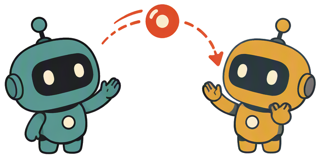

<p align="center">
  <a href="https://github.com/SotherWind/memrelay">
    
  </a>
</p>

<h1 align="center">MemRelay</h1>

<p align="center">
  <a href="README-en.md">English</a> ·
  <a href="README-de.md">Deutsch</a> ·
  <a href="README-es.md">Español</a> ·
  <a href="README-fr.md">Français</a> ·
  <a href="README-ja.md">日本語</a> ·
  <a href="README-ko.md">한국어</a> ·
  <a href="README-fa.md">فارسی</a> ·
  <a href="README-pt-BR.md">Português</a> ·
  <strong>Bahasa Indonesia</strong> ·
  <a href="README.md">简体中文</a> ·
  <a href="README-zh-Hant.md">繁體中文</a>
</p>

<p align="center">
  <strong>Relai tugas antar alat coding AI.</strong><br>
  Baru setengah jalan di Codex tetapi kuota habis? Pindah ke Claude Code dan cukup katakan
  «lanjutkan tugas XX» — ia melanjutkan dari titik terakhir Anda,
  tanpa perlu menjelaskan ulang kebutuhan atau progres.
</p>

<p align="center">
  <a href="https://www.npmjs.com/package/memrelay"></a>
  <a href="https://www.npmjs.com/package/memrelay"></a>
  <a href="https://github.com/SotherWind/memrelay/actions/workflows/ci.yml"></a>
  <a href="https://github.com/SotherWind/memrelay/blob/main/LICENSE"></a>
  = 22.16">
  
</p>

<p align="center">
  <a href="#instalasi">Instalasi</a> ·
  <a href="#mulai-cepat">Mulai cepat</a> ·
  <a href="#sorotan">Sorotan</a> ·
  <a href="#perintah">Perintah</a> ·
  <a href="#sumber-yang-didukung">Sumber yang didukung</a> ·
  <a href="#batasan-yang-diketahui">Batasan yang diketahui</a> ·
  <a href="#antarmuka-web">Antarmuka web</a> ·
  <a href="#pengembangan">Pengembangan</a>
</p>

## Mengapa MemRelay

Berganti alat AI seharusnya tidak menghilangkan progres.

Anda baru setengah jalan di Codex ketika kuota habis. Ingin melanjutkan di Claude Code, tetapi alat itu tidak tahu apa yang baru saja terjadi. Jadi Anda menjelaskan ulang kebutuhan, menceritakan ulang progres — atau menyerah.

MemRelay membaca catatan sesi yang disimpan setiap alat di komputer Anda dan, saat Anda mengatakan «lanjutkan», merangkum materi serah-terima saat itu juga. **Alat lama tidak perlu melakukan apa pun — tanpa dokumen serah-terima, tanpa salin-tempel.**

## Sorotan

- **Tanpa kerja sama dari agen lama** — tidak meminta apa pun dari alat lama; membaca catatan sesi lokalnya dan merangkum progres, sisa pekerjaan, serta langkah berikutnya.
- **Sekali pasang, lalu bicara seperti biasa** — setelah `memrelay setup` Anda tidak perlu menyebut memrelay; di alat yang memiliki Skill atau petunjuk mulai, «lanjutkan tugas XX» terpicu otomatis.
- **Progres tetap terkini** — dengan persetujuan Anda, ia terpasang di hooks alat; progres masuk ke indeks lokal hampir real-time dan alat berikutnya bisa langsung melanjutkan.
- **Alat utama tercakup** — membaca sesi Claude Code, Qoder, Codex, Cursor, CodeBuddy, WorkBuddy, OpenCode, ZCode, Trae / Trae CN, dan DeepSeek Harness (Trae CN dan CodeBuddy dalam format CLI dan IDE).
- **Tanpa LLM** — materi serah-terima diekstrak lokal dengan aturan; offline secara default dan tanpa API key; pencarian semantik vektor, ringkasan sesi, dan penataan preferensi adalah peningkatan opsional opt-in (lihat di bawah).
- **Lokal dulu dan bisa dibatalkan** — data hanya di `~/.memrelay/`, tanpa telemetri; sesi alat lain hanya dibaca, dan setiap penulisan integrasi atau penataan preferensi tercatat di manifes serta bisa dibatalkan.

## Instalasi

Memerlukan Node.js ≥ 22.16 (nvm / fnm / volta / mise semuanya bisa — launcher mencari Node yang sesuai sendiri):

```bash
npm i -g memrelay    # instalasi global dengan pnpm / yarn / bun juga bisa
memrelay setup
```

`setup` akan: **mendeteksi** alat yang terpasang → **mendaftar** file yang akan ditulis (petunjuk mulai + indeks real-time) → **konfirmasi sekali** → menulis → uji mandiri di setiap terminal.

> [!NOTE]
> Ingin mencoba tanpa jejak? `memrelay setup --undo` mengembalikan semua yang ditulis (data tetap disimpan); tambahkan `--purge` untuk menghapus datanya juga.

## Mulai cepat

```bash
npm i -g memrelay && memrelay setup
```

Lalu buka proyek yang «setengah jalan dengan alat lain» dan katakan, di alat terintegrasi yang memiliki Skill atau petunjuk mulai:

> lanjutkan tugas XX

Agent menjalankan `memrelay resume` secara otomatis, menerima serah-terima (alat mana, sejauh mana, apa berikutnya), lalu melanjutkan.

## Perintah

Dijalankan otomatis oleh agent (hanya baca, hanya cetak):

| Perintah | Fungsi |
|---|---|
| `memrelay resume "kata kunci"` | Menemukan tugas yang terputus dan mencetak serah-terima; rantai relai antar alat ikut disertakan |
| `memrelay resume` | Tanpa kata kunci: mengambil tugas terputus terbaru di proyek saat ini |
| `memrelay resume <id sesi>` | Melanjutkan sesi tersebut secara tepat setelah dipilih dari menu; keluaran membawa penanda relai agar sesi baru bergabung ke rantai |
| `memrelay search "kata kunci"` | Mencari di sesi proyek saat ini (teks CJK dapat dicari) |
| `memrelay show <id sesi> --from N` | Menelusuri catatan mentah sebuah sesi |

Yang Anda jalankan sendiri:

| Perintah | Fungsi |
|---|---|
| `memrelay doctor` | Uji mandiri + membangun/memperbarui indeks sesi secara inkremental (`~/.memrelay/memrelay.db`) |
| `memrelay ui` | Antarmuka web lokal (lihat di bawah) |
| `memrelay embed [--status]` | Pengisian vektor: menyematkan teks dan menyimpannya di penyimpanan lokal (aktifkan pencarian semantik di Pengaturan dulu); `--status` menampilkan progres |
| `memrelay summarize [--status]` | Ringkasan sesi: memadatkan ujung sesi menjadi ringkasan progres 2–4 kalimat lewat endpoint ringkasan; `--status` menampilkan progres |
| `memrelay tidy [--status\|--apply\|--undo]` | Penataan preferensi antar alat: mengimpor memori/aturan global tiap alat, menggabungkannya, lalu menulis balik blok penanda MemRelay |
| `memrelay setup --undo` | Membatalkan integrasi (data tetap); tambahkan `--purge` untuk menghapus data juga |

## Sumber yang didukung

Sesi dibaca langsung — alat sumber tidak perlu melakukan apa pun:

| Alat | Lokasi sesinya di mesin ini |
|---|---|
| Claude Code | `~/.claude/projects/<encoded-path>/*.jsonl` |
| Qoder | `~/.qoder/projects/<encoded-path>/*.jsonl` (termasuk format transcript IDE) |
| Codex | `~/.codex/sessions/YYYY/MM/DD/rollout-*.jsonl[.zst]` (metadata dari `state_*.sqlite` hanya-baca) |
| Cursor | `%APPDATA%/Cursor/User/globalStorage/state.vscdb` (KV teks biasa, hanya-baca) |
| CodeBuddy | CLI: `~/.codebuddy/projects/…/*.jsonl`; IDE: `%LOCALAPPDATA%/CodeBuddyExtension/Data/…/CodeBuddyIDE/…/history/<md5 workspace>/<sesi>` (satu file JSON per pesan) |
| WorkBuddy | `~/.workbuddy/projects/…/*.jsonl` + metadata `workbuddy.db` |
| OpenCode | `~/.local/share/opencode/opencode.db` |
| ZCode | `~/.zcode/cli/db/db.sqlite` |
| Trae / Trae CN | CLI Trae memakai format kompatibel Codex; penyimpanan sesi IDE Trae CN terenkripsi dan direkonstruksi dari event hook (Trae internasional: hanya CLI) |
| DeepSeek Harness | `~/.dsh/sessions/<encoded-project-dir>/session-<id>/session.v4.jsonl.zstd` (zstd multi-frame, hanya-baca) |

> [!NOTE]
> Path mengikuti direktori data default tiap platform: baris Cursor / CodeBuddy di atas adalah path Windows; di macOS `~/Library/Application Support/…`, di Linux `~/.config/…`. OpenCode memakai `~/.local/share/opencode` di semua platform, dan `~` adalah direktori home pengguna saat ini.

Integrasi punya dua lapis, semuanya tercatat di manifes dan bisa dibatalkan: **Skill** (mengajari alat untuk memanggil memrelay saat Anda mengatakan «lanjutkan») dipasang di direktori skill Claude Code / Qoder / Codex / Cursor / CodeBuddy / WorkBuddy / Trae / Trae CN / DeepSeek Harness; **indeks real-time** (progres kerja masuk ke indeks dalam hitungan detik) dipasang di Claude Code / Qoder / Codex / CodeBuddy / WorkBuddy / ZCode / Trae CN (trio hooks; CLI dan IDE CodeBuddy berbagi pengaturan pengguna yang sama) serta OpenCode / DeepSeek Harness (mekanisme plugin resmi masing-masing) — dsh memakai plugin in-process untuk indeks real-time (menghindari batasan proses sandbox-nya) dan juga memasang jembatan kompatibilitas hooks resmi untuk petunjuk mulai dan kompatibilitas.

## Batasan yang diketahui

- **Pemicuan otomatis bergantung pada Skill atau petunjuk mulai**: OpenCode saat ini hanya memiliki plugin indeks real-time, tanpa petunjuk mulai, jadi jalankan `memrelay resume` secara manual di sana.
- **Penyimpanan sesi IDE Trae CN terenkripsi**: sesi hanya direkonstruksi dari event hook saat indeks real-time aktif; jika hanya Skill yang aktif dan indeks real-time tidak, sesi lama tidak dapat dibaca.
- **Hanya sesi lokal**: tidak ada sinkronisasi antar mesin; alat yang tidak didukung, atau sesi terenkripsi tanpa aliran event, tidak dapat dibaca.

## Antarmuka web

```bash
memrelay ui
```

Membuka antarmuka lokal yang hanya mendengarkan di `127.0.0.1` (token sekali pakai; data tidak keluar dari mesin Anda). Memakai port tetap `4823` secara default (acak jika sedang dipakai); tema dan bahasa disimpan di localStorage browser dan dipulihkan saat dijalankan lagi.

- **Dasbor**: ringkasan status, tugas siap dilanjutkan, tugas terbaru, aktivitas 14 hari terakhir, dan distribusi alat/folder
- **Daftar tugas**: rantai relai antar alat digabung menjadi satu tugas; dikelompokkan per folder dan diurutkan berdasarkan aktivitas terbaru, dengan status real-time
- **Detail tugas**: jalur relai vertikal + pratinjau serah-terima + salin prompt serah-terima sekali klik
- **Penataan**: penataan preferensi antar-alat; kartu terpisah untuk yang sudah diterapkan dan yang menunggu keputusan, bisa dibatalkan
- **Pengaturan**: antarmuka dan sakelar untuk ringkasan, penataan, dan pencarian semantik, integrasi otomatis alat baru, serta status proses
- **Tiga skin**: minimal / komik / piksel × terang / gelap / sistem; pilihan tema dan bahasa diingat
- **11 bahasa antarmuka**: Mandarin sederhana / English / Mandarin tradisional / 日本語 / 한국어 / Español / Français / Deutsch / فارسی / Português (BR) / Bahasa Indonesia
- **Penjelajahan & pencarian sesi**: pencarian teks lengkap (termasuk CJK), melompat ke kecocokan dengan sorotan
- **Manajemen integrasi / pengecualian privasi / tempat sampah / koreksi manual** (ganti nama, tandai selesai, pisahkan & gabungkan rantai)

## Peningkatan opsional

Pencarian semantik, ringkasan sesi, dan penataan preferensi nonaktif secara default. Masing-masing punya pengaturan endpoint sendiri di `memrelay ui` (independen dan bisa mengarah ke upstream berbeda). Kunci disamarkan sebelum dikirim; jika pencarian semantik atau ringkasan gagal, keduanya kembali ke ekstraksi berbasis aturan yang ada; jika penataan gagal, tidak ada yang ditulis balik.

- **Pencarian semantik**: menambah kanal semantik sehingga mencari «halaman login» juga menemukan sesi yang menulis "auth page". Hanya teks user/assistant yang di-embed, dan hanya `/embeddings` jarak jauh yang kompatibel dengan OpenAI yang didukung. Referensi skala: ~250 sesi ≈ 2 juta karakter ≈ US$0,03. Konten yang tidak berubah dilewati lewat rekonsiliasi hash; saat berganti model/host, tersedia pembangunan ulang sekali klik. [Desain](docs/vector-search.md)
- **Ringkasan sesi**: membuat ringkasan progres 2–4 kalimat per sesi, ditampilkan di keluaran relai (`## 任务摘要（AI 生成）`), daftar & detail tugas, dan penjelajahan sesi. Materi dibatasi pada judul, sinyal status, dan ~20 pesan terakhir di ujung sesi (≤8KB); penalaran dan keluaran alat tidak dikirim. ~1 juta token untuk 250 sesi. Materi yang tidak berubah dilewati; saat berganti model/host, tersedia pembangunan ulang sekali klik. [Desain](docs/llm-summary.md)
- **Penataan preferensi**: mengimpor memori/aturan global tiap alat secara hanya-baca, menggabungkan duplikat dan konflik, lalu menulis balik blok penanda MemRelay. Hanya menyentuh blok penanda atau file khusus, membuat cadangan sebelum menulis, bisa dibatalkan, dan menampilkan konflik alih-alih menyelesaikannya otomatis; perubahan sumber diperiksa otomatis saat `memrelay ui` berjalan. [Desain](docs/tidy.md)

Pemeliharaan: `memrelay embed` / `memrelay summarize` / `memrelay tidy` untuk pengisian penuh (bisa dihentikan dan dilanjutkan); `memrelay ui` mengisi/memeriksa di latar belakang saat berjalan.

## Privasi dan keamanan

- Data hanya berada di `~/.memrelay/` di mesin Anda; tanpa telemetri; tanpa layanan cloud secara default.
- Sesi alat lain hanya dibaca; penulisan terbatas pada integrasi yang Anda setujui (Skill, konfigurasi hooks / plugin), blok penanda MemRelay atau file khusus yang ditulis oleh penataan preferensi, dan `~/.memrelay/`; semuanya tercatat di manifes dan bisa dibatalkan.
- Kunci (API key, token, kunci privat, string koneksi) dideteksi dan disamarkan sebelum indeks dan keluaran.
- Saat pencarian semantik, ringkasan sesi, atau penataan preferensi aktif, teks/memori terkait (kunci sudah disamarkan) dikirim ke host yang Anda konfigurasi (ketiganya punya endpoint sendiri); ketiganya nonaktif secara default.
- Server antarmuka hanya mendengarkan di `127.0.0.1`, memerlukan token akses dan memvalidasi header Host; permintaan tulis juga menolak Origin lintas asal.
- Hook IDE Trae CN berjalan di sandbox Trae sendiri dan hanya bisa menaruh event mentah di `hooks_env` Trae; kunci umum (`sk-`, token GitHub, kunci AWS, field `password/token`) disamarkan dulu di dalam sandbox, tetapi konten di luar aturan tersebut bisa tetap ada di salinan itu. Membatalkan integrasi akan menghapus file tersebut. Jika ini penting bagi Anda, aktifkan hanya Skill Trae CN dan lewati indeks real-time.

## Pengembangan

Repositori ini adalah pnpm workspace: `packages/cli` adalah paket CLI utama (artefak yang dipublikasikan) dan `packages/ui` adalah antarmuka web (hasil build digabung ke `dist/ui` CLI).

```bash
pnpm install
pnpm typecheck     # tsc --noEmit untuk kedua paket
pnpm test          # tes unit + integrasi vitest (e2e terpisah, lihat di bawah)
pnpm build         # pertama tsdown → packages/cli/dist/cli.mjs, lalu antarmuka ke packages/cli/dist/ui
cd packages/cli && npm link   # opsional: menaruh memrelay di PATH (sama dengan npm i -g memrelay)
node packages/cli/test/e2e/bootstrap.mjs   # end-to-end launcher
```

Desain dan rencana iterasi: [docs/architecture.md](docs/architecture.md).

## License

[MIT](LICENSE)
