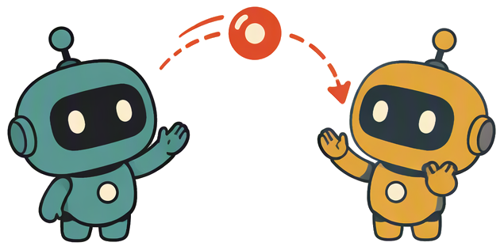

<p align="center">
  <a href="https://github.com/SotherWind/memrelay">
    
  </a>
</p>

<h1 align="center">MemRelay</h1>

<p align="center">
  <a href="README-en.md">English</a> ·
  <a href="README-de.md">Deutsch</a> ·
  <a href="README-es.md">Español</a> ·
  <a href="README-fr.md">Français</a> ·
  <a href="README-ja.md">日本語</a> ·
  <strong>한국어</strong> ·
  <a href="README-fa.md">فارسی</a> ·
  <a href="README-pt-BR.md">Português</a> ·
  <a href="README-id.md">Bahasa Indonesia</a> ·
  <a href="README.md">简体中文</a> ·
  <a href="README-zh-Hant.md">繁體中文</a>
</p>

<p align="center">
  <strong>AI 코딩 도구를 넘나드는 작업 릴레이.</strong><br>
  Codex에서 절반쯤 하다가 사용량이 바닥났다면——Claude Code로 전환해
  「XX 작업을 계속해」라고 평소처럼 말하기만 하면, 요구사항과 진행 상황을 다시 설명하지 않아도 이어서 작업합니다.
</p>

<p align="center">
  <a href="https://www.npmjs.com/package/memrelay"></a>
  <a href="https://www.npmjs.com/package/memrelay"></a>
  <a href="https://github.com/SotherWind/memrelay/actions/workflows/ci.yml"></a>
  <a href="https://github.com/SotherWind/memrelay/blob/main/LICENSE"></a>
  = 22.16">
  
</p>

<p align="center">
  <a href="#설치">설치</a> ·
  <a href="#빠른-시작">빠른 시작</a> ·
  <a href="#주요-기능">주요 기능</a> ·
  <a href="#명령어">명령어</a> ·
  <a href="#지원-소스">지원 소스</a> ·
  <a href="#알려진-제한">알려진 제한</a> ·
  <a href="#웹-ui">웹 UI</a> ·
  <a href="#개발">개발</a>
</p>

## MemRelay가 필요한 이유

AI 도구를 바꾼다고 진행 상황을 잃어서는 안 됩니다.

Codex에서 절반쯤 작성했는데 할당량이 끝났습니다. Claude Code로 이어서 하고 싶지만, 방금 무슨 일이 있었는지 모릅니다. 요구사항을 다시 설명하고, 진행 상황을 다시 설명하거나——아예 포기해야 합니다.

MemRelay는 각 도구가 로컬에 남긴 세션 기록을 직접 읽고, 당신이 「계속」이라고 말하는 순간 이어받을 내용을 그 자리에서 추출합니다. **기존 도구의 협조가 필요 없고, 인수인계 문서도 복사·붙여넣기도 필요 없습니다.**

## 주요 기능

- **기존 에이전트의 협조 불필요** — 기존 도구에 아무것도 요구하지 않습니다. 로컬 세션 기록을 직접 읽어 진행 상황, 남은 작업, 다음 단계를 즉석에서 추출합니다.
- **한 번 연결하면 평소처럼 말하면 됩니다** — `memrelay setup` 후에는 memrelay를 특별히 언급할 필요 없이, Skill 또는 시작 힌트가 있는 도구에서 「XX 작업을 계속해」라고 하면 자동으로 실행됩니다.
- **진행 상황이 자동으로 따라옵니다** — 동의 후 도구의 hooks에 설치되어 작업 진행 상황이 실시간에 가깝게 로컬 인덱스에 기록되고, 다른 도구로 전환하면 바로 이어받을 수 있습니다.
- **주요 도구 전부 지원** — Claude Code, Qoder, Codex, Cursor, CodeBuddy, WorkBuddy, OpenCode, ZCode, Trae, DeepSeek Harness의 세션을 읽습니다 (Trae, CodeBuddy는 CLI와 IDE 두 형식 모두 지원).
- **LLM 불필요** — 인수인계 내용은 규칙 기반으로 로컬에서 추출하며 기본적으로 오프라인, API 키도 필요 없습니다. 벡터 의미 검색, 세션 요약, 환경설정 정리는 선택적 옵트인 확장입니다 (아래 참고).
- **로컬 우선, 되돌릴 수 있음** — 데이터는 `~/.memrelay/`에만 저장되고 텔레메트리는 없습니다. 다른 도구에는 읽기 전용이며 모든 쓰기는 매니페스트에 기록되어 원클릭으로 되돌릴 수 있습니다.

## 설치

Node.js ≥ 22.16 필요 (nvm / fnm / volta / mise 모두 가능——런처가 사용 가능한 Node를 스스로 찾습니다):

```bash
npm i -g memrelay    # pnpm / yarn / bun 전역 설치도 동일하게 사용 가능
memrelay setup
```

`setup`은: 설치된 도구 **감지** → 기록할 파일 **목록 표시** (시작 힌트 + 실시간 인덱스) → **한 번 확인** → 기록 → 각 터미널에서 자체 테스트.

> [!NOTE]
> 흔적 없이 먼저 시험해 보고 싶다면? `memrelay setup --undo`로 기록을 한 번에 되돌립니다 (데이터는 유지). `--purge`를 추가하면 데이터도 삭제합니다.

## 빠른 시작

```bash
npm i -g memrelay && memrelay setup
```

그다음 '다른 도구로 절반까지 진행한' 프로젝트를 열고, Skill 또는 시작 힌트가 있는 연동 도구에서 이렇게 말하세요:

> XX 작업을 계속해

에이전트가 자동으로 `memrelay resume`를 실행해 인수인계 내용(어느 도구에서, 어디까지, 다음에 무엇을)을 받아 이어서 작업합니다.

## 명령어

에이전트가 세션 안에서 자동 실행 (읽기 전용, 출력만):

| 명령어 | 동작 |
|---|---|
| `memrelay resume "키워드"` | 중단된 작업을 찾아 인수인계 내용을 출력; 도구를 넘나드는 릴레이 체인도 함께 포함 |
| `memrelay resume` | 키워드 없이: 현재 프로젝트에서 가장 최근에 중단된 작업을 이어받기 |
| `memrelay resume <세션 id>` | 후보 메뉴에서 선택한 세션을 정확히 이어받습니다. 출력에 릴레이 마커가 포함되어 새 세션이 체인에 연결됩니다 |
| `memrelay search "키워드"` | 현재 프로젝트의 세션 검색 (중국어 두 글자 단어도 검색 가능) |
| `memrelay show <세션 ID> --from N` | 세션의 원본 기록을 펼쳐 보기 |

직접 실행하는 명령어:

| 명령어 | 동작 |
|---|---|
| `memrelay doctor` | 자체 점검 + 세션 인덱스 생성/증분 업데이트 (`~/.memrelay/memrelay.db`) |
| `memrelay ui` | 로컬 웹 UI (아래 참고) |
| `memrelay embed [--status]` | 벡터 백필: 본문을 임베딩해 DB에 저장 (설정 페이지에서 시맨틱 검색을 먼저 켜야 함); `--status`로 진행 상황 확인 |
| `memrelay summarize [--status]` | 세션 요약: 설정 페이지에 입력한 요약 엔드포인트로 2~4문장 진행 요약 생성; `--status`로 진행 상황 확인 |
| `memrelay tidy [--status\|--apply\|--undo]` | 도구 간 환경설정 정리: 각 도구의 전역 메모리/규칙을 가져와 병합한 뒤 MemRelay 표시 블록으로 기록 |
| `memrelay setup --undo` | 연동 취소 (데이터 유지); `--purge`를 추가하면 데이터도 삭제 |

## 지원 소스

세션 기록을 직접 읽으며, 해당 도구의 협조가 필요 없습니다:

| 도구 | 세션이 저장되는 위치 |
|---|---|
| Claude Code | `~/.claude/projects/<encoded-path>/*.jsonl` |
| Qoder | `~/.qoder/projects/<encoded-path>/*.jsonl` (IDE transcript 형식 포함) |
| Codex | `~/.codex/sessions/YYYY/MM/DD/rollout-*.jsonl[.zst]` (메타데이터는 읽기 전용 `state_*.sqlite`에서) |
| Cursor | `%APPDATA%/Cursor/User/globalStorage/state.vscdb` (평문 KV, 읽기 전용) |
| CodeBuddy | CLI: `~/.codebuddy/projects/…/*.jsonl`; IDE: `%LOCALAPPDATA%/CodeBuddyExtension/Data/…/CodeBuddyIDE/…/history/<워크스페이스 md5>/<세션>` (메시지마다 JSON 하나) |
| WorkBuddy | `~/.workbuddy/projects/…/*.jsonl` + `workbuddy.db` 메타데이터 |
| OpenCode | `~/.local/share/opencode/opencode.db` |
| ZCode | `~/.zcode/cli/db/db.sqlite` |
| Trae / Trae CN | CLI는 Codex 호환 형식; IDE 세션 저장소는 암호화되어 있어 hook 이벤트로 실시간 재구성 |
| DeepSeek Harness | `~/.dsh/sessions/<encoded-project-dir>/session-<id>/session.v4.jsonl.zstd` (멀티프레임 zstd, 읽기 전용) |

> [!NOTE]
> 경로는 각 플랫폼의 기본 데이터 디렉터리를 따릅니다: 위 표의 Cursor / CodeBuddy는 Windows 경로이며, macOS에서는 `~/Library/Application Support/…`, Linux에서는 `~/.config/…`입니다. OpenCode는 모든 플랫폼에서 `~/.local/share/opencode`를 사용하고, `~`는 현재 사용자의 홈 디렉터리입니다.

연동은 두 계층이며 모두 매니페스트로 관리되고 되돌릴 수 있습니다: **Skill** (「계속」이라고 할 때 memrelay를 호출하도록 도구에 알려 줌)은 Claude Code / Qoder / Codex / Cursor / CodeBuddy / WorkBuddy / Trae / Trae CN / DeepSeek Harness의 스킬 디렉터리에 기록됩니다. **실시간 인덱스** (작업 진행 상황을 초 단위로 반영)는 Claude Code / Qoder / Codex / CodeBuddy / WorkBuddy / ZCode / Trae CN (hooks 세트; CodeBuddy의 CLI와 IDE는 동일한 사용자 설정 공유)과 OpenCode / DeepSeek Harness (각 공식 플러그인 메커니즘)에 설치됩니다. dsh의 실시간 인덱스는 프로세스 내 플러그인을 사용하고(샌드박스의 hook 프로세스 제한 우회), 공식 hooks 호환 브리지를 추가로 설치해 시작 힌트와 호환성을 담당합니다.

## 알려진 제한

- **자동 실행은 Skill 또는 시작 힌트에 의존합니다**: OpenCode는 현재 실시간 인덱스 플러그인만 있고 시작 힌트가 없으므로, 직접 `memrelay resume`를 실행해야 합니다.
- **Trae IDE의 세션 저장소는 암호화되어 있습니다**: 실시간 인덱스를 켠 경우에만 hook 이벤트로 세션을 재구성할 수 있으며, Skill만 켜고 실시간 인덱스를 켜지 않으면 과거 세션을 읽을 수 없습니다.
- **로컬 세션만 처리합니다**: 기기 간 동기화는 하지 않으며, 지원되지 않는 도구나 암호화되어 있고 이벤트 스트림이 없는 세션은 읽을 수 없습니다.

## 웹 UI

```bash
memrelay ui
```

`127.0.0.1`에서만 수신하는 로컬 화면을 엽니다 (일회성 토큰 포함, 데이터는 기기 밖으로 나가지 않음). 기본은 고정 포트 `4823` (사용 중이면 임의 포트); 테마와 언어는 브라우저 localStorage에 저장되어 다음 실행 시 유지됩니다.

- **대시보드**: 상태 개요, 이어받을 작업, 최근 작업, 최근 14일 활동과 도구/폴더 분포
- **작업 목록**: 도구를 넘나드는 릴레이 체인을 하나의 작업으로 합치고, 폴더별로 묶어 최근 활동 순으로 정렬하며 상태를 실시간 갱신
- **작업 상세**: 세로 릴레이 레일 + 인수인계 미리보기 + 인수인계 프롬프트 원클릭 복사
- **세 가지 스킨**: 미니멀 / 코믹 / 픽셀 × 라이트 / 다크 / 시스템; 테마와 언어 선택은 기억됩니다
- **11개 UI 언어**: 중국어(간체) / English / 중국어(번체) / 日本語 / 한국어 / Español / Français / Deutsch / فارسی / Português (BR) / Bahasa Indonesia
- **세션 탐색과 검색**: 전체 텍스트 검색 (중국어 지원), 일치 지점을 강조해 바로 이동
- **연동 관리 / 개인정보 제외 / 휴지통 / 수동 수정** (이름 변경, 완료 표시, 릴레이 체인 분할·병합)

## 선택적 확장

시맨틱 검색, 세션 요약, 환경설정 정리는 기본적으로 꺼져 있습니다. 각각 `memrelay ui` 설정 페이지에서 별도 엔드포인트를 설정하며(서로 독립적이고 다른 업스트림을 지정할 수 있음), 전송 전에 키를 마스킹합니다. 시맨틱 검색과 요약은 실패 시 기존 규칙 추출로 돌아가고, 정리는 실패 시 아무것도 기록하지 않습니다.

- **시맨틱 검색**: 시맨틱 채널을 추가해 「로그인 페이지」로 검색해도 "auth page"라고 적힌 세션을 찾습니다. user/assistant 본문만 임베딩하며 OpenAI 호환 원격 `/embeddings`만 지원합니다. 참고 규모: 약 250개 세션 ≈ 2M 자 ≈ $0.03. 변경되지 않은 내용은 해시 대조로 건너뛰고, 모델/호스트 변경 시 원클릭으로 재구축할 수 있습니다. [설계](docs/vector-search.md)
- **세션 요약**: 세션마다 2~4문장 진행 요약을 생성해 릴레이 출력(`## 任务摘要（AI 生成）`), 작업 목록과 상세, 세션 탐색에 표시합니다. 재료는 제목, 상태 신호, 세션 끝부분의 최근 약 20개 메시지(≤8KB)로 제한하며 사고 과정과 도구 출력은 보내지 않습니다. 250개 세션 전체 약 1M 토큰. 재료가 바뀌지 않으면 건너뛰고, 모델/호스트 변경 시 원클릭으로 재구축할 수 있습니다. [설계](docs/llm-summary.md)
- **환경설정 정리**: 각 도구의 전역 메모리/규칙을 읽기 전용으로 가져와 중복과 충돌을 병합한 뒤 MemRelay 표시 블록으로 다시 기록합니다. 표시 블록만 수정하고, 쓰기 전에 백업하며, 되돌릴 수 있고, 충돌은 자동 판정하지 않고 표시합니다. `memrelay ui` 실행 중에는 소스 변경을 자동으로 확인합니다. [설계](docs/tidy.md)

유지보수: `memrelay embed` / `memrelay summarize` / `memrelay tidy`로 전체 채우기(중단·재개 가능); `memrelay ui` 실행 중에는 백그라운드에서 보충/확인합니다.

## 개인정보 보호 및 보안

- 데이터는 로컬 `~/.memrelay/`에만 저장되며 텔레메트리는 없습니다. 기본적으로 클라우드 서비스에 의존하지 않습니다.
- 다른 도구의 로컬 파일은 읽기 전용이며, 쓰기는 Skill / hooks 설정과 `~/.memrelay/`로 제한되고 모두 매니페스트로 관리되어 되돌릴 수 있습니다.
- 인덱싱과 출력 전에 키를 감지하고 가립니다 (API 키, 토큰, 개인 키, 연결 문자열 등).
- 시맨틱 검색, 세션 요약, 환경설정 정리를 켜면 관련 본문/메모리(키 마스킹 완료)가 설정에서 지정한 엔드포인트 호스트로 전송됩니다 (세 기능 각각 독립된 엔드포인트). 기본은 꺼짐.
- 화면 서버는 `127.0.0.1`만 수신하고 액세스 토큰과 Host 헤더를 검증합니다. 쓰기 요청은 추가로 교차 출처 Origin을 거부합니다.
- Trae IDE의 hook은 Trae 자체 샌드박스에서 실행되어 원본 이벤트를 먼저 Trae의 `hooks_env`에 기록할 수만 있습니다. 일반적인 키(`sk-`, GitHub 토큰, AWS 키, `password/token` 필드)는 샌드박스 안에서 먼저 마스킹되지만, 규칙이 덮지 못하는 내용은 그 사본에 남을 수 있습니다. 연동을 취소하면 이 파일들이 삭제됩니다. 민감한 환경이라면 Trae의 Skill만 켜고 실시간 인덱스는 끄면 됩니다.

## 개발

저장소는 pnpm workspace입니다: `packages/cli`는 CLI 본체(배포물), `packages/ui`는 웹 UI(빌드 결과물은 CLI의 `dist/ui`로 병합).

```bash
pnpm install
pnpm typecheck     # 두 패키지의 tsc --noEmit
pnpm test          # vitest 단위 + 통합 테스트 (E2E는 별도, 아래 참고)
pnpm build         # 먼저 tsdown → packages/cli/dist/cli.mjs, 그다음 화면을 packages/cli/dist/ui로
cd packages/cli && npm link   # 선택: memrelay를 PATH에 추가 (npm i -g memrelay와 동일)
node packages/cli/test/e2e/bootstrap.mjs   # 런처 엔드투엔드
```

설계와 반복 계획: [docs/architecture.md](docs/architecture.md).

## License

[MIT](LICENSE)
